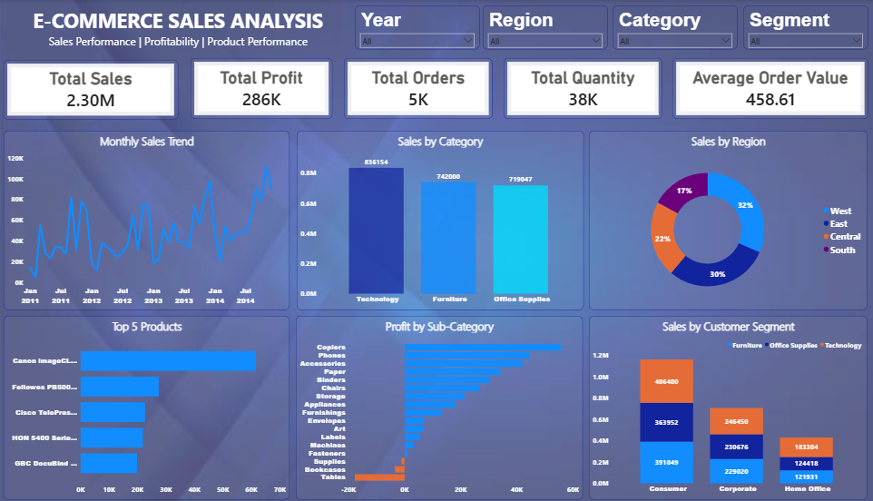

# E-Commerce Sales Analysis Dashboard

Power BI dashboard analysing sales performance, profitability and product performance across regions, categories and customer segments.

## Key Insights
- Total Sales: 2.30M | Total Profit: 286K
- 5K orders, 38K units sold, average order value 458.61
- Technology is the top category by sales (836K)
- West leads regions with 32% of sales
- Consumer is the largest customer segment
- Copiers are the most profitable sub-category; Tables show a loss

## Dashboard Preview

## Tools Used
- Power BI
- DAX
- Data Visualization
